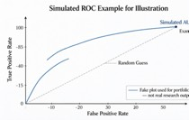

# Maggie Hao
Student ID: MC64199

## Short Introduction
I am a postgraduate student majoring in Data Science and Marketing Analytics. My research interests include longitudinal survey analysis, behavioural analytics and health-related psychological modelling. This portfolio is built for the CISC7204 coursework assessment.

## Technical Skills
- Programming: Python (Pandas, NumPy, Scikit-learn, Matplotlib, Seaborn)
- Statistical methods: Logistic regression, missing data handling, ROC-AUC evaluation
- Tools: Jupyter Notebook, GitHub & GitHub Pages

## Project Showcase
### Project Title
Body Image Anxiety among University Students: A Longitudinal Data Analysis

### Research Question
How do socio-demographic factors, self-perceived weight status and social media exposure predict the risk of elevated body image anxiety among university students over multiple survey waves?

### Visualization & Brief Explanation of Findings

This flowchart illustrates the full analytical workflow for this study.
The demo result (simulated only, not my real research output): In the synthetic demonstration dataset, frequent social media appearance comparison and negative weight self-perception are associated with higher risk of body image anxiety, with a demo logistic model AUC of 0.72.

> Note: All outputs shown here are synthetic illustrations for coursework. Full confidential research results are submitted privately via Moodle.

### Project Repository Link
https://github.com/MaggieHao/data-science-project

### Current project status
ongoing
